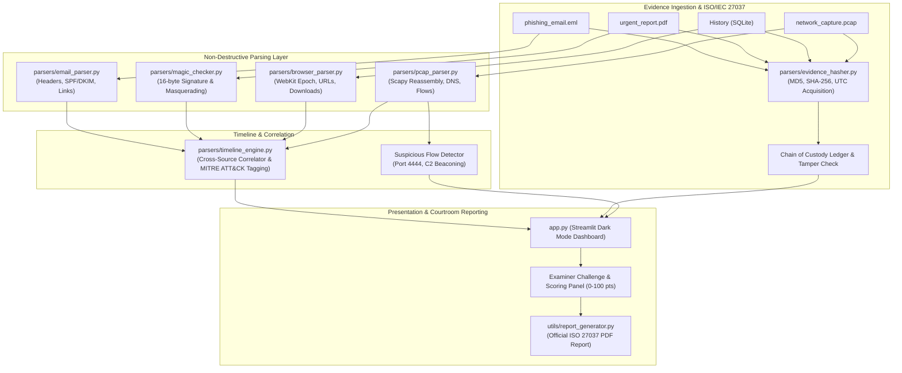

# 🛡️ CyberTrace: DFIR Investigation Workbench & Crime Scene Sandbox

[](https://www.python.org/)
[](https://streamlit.io/)
[](https://www.iso.org/standard/44381.html)
[](LICENSE)

**CyberTrace** is an enterprise-grade Digital Forensics & Incident Response (DFIR) investigation workbench and synthetic crime scene sandbox. Engineered for cyber forensics laboratories and incident responders, CyberTrace provides non-destructive evidence ingestion, cryptographic integrity verification, multi-source event correlation, MITRE ATT&CK mapping, and automated courtroom-ready PDF reporting.

---

## 🏛️ Academic Syllabus & Laboratory Alignment

CyberTrace directly satisfies academic rubrics for undergraduate and graduate Cyber Forensics curricula:

| Module / Week | Forensic Discipline | CyberTrace Implementation |
| :--- | :--- | :--- |
| **Week 1** | **Email Header & Phishing Forensics** | `parsers/email_parser.py`: RFC 822 / MIME parsing, originating IP tracing via `Received` header chains, SPF/DKIM authentication failure detection, embedded hyperlink inspection. |
| **Week 2–3** | **Web Browser Artifact Forensics** | `parsers/browser_parser.py`: SQLite parsing of Chromium `urls`, `visits`, and `downloads` tables. WebKit epoch microsecond timestamp conversion to UTC. |
| **Week 4–5** | **File Signature & Masquerading** | `parsers/magic_checker.py`: 16-byte binary header inspection, magic number detection (PE, PDF, PNG, ZIP, SQLite, ELF), and file extension spoofing alerts (MITRE ATT&CK T1036). |
| **Week 6–8** | **Network Traffic Dissection** | `parsers/pcap_parser.py`: Scapy packet reassembly, DNS query extraction, TCP handshake tracking, unencrypted port alerting, and port 4444 reverse shell detection. |
| **Capstone** | **Multi-Source Correlation & Reporting** | `parsers/timeline_engine.py` & `utils/report_generator.py`: Master chronological event correlation, MITRE ATT&CK tagging, ISO/IEC 27037 chain of custody, and ReportLab PDF courtroom report compilation. |

---

## ⚙️ System Architecture



---

## 🚀 Quickstart & Installation

### 1. Clone & Set Up Environment
```bash
git clone https://github.com/CR2622/CF-CBP.git
cd CF-CBP
pip install -r requirements.txt
```

### 2. Generate Synthetic Crime Scene Data
To populate the test sandbox with a complete multi-artifact incident:
```bash
python generate_mock_evidence.py
```
This generates:
- `mock_case/phishing_email.eml` (Phishing email with failed SPF/DKIM)
- `mock_case/urgent_report.pdf` (Disguised PE executable with `MZ` header)
- `mock_case/History` (Chromium SQLite database with intranet searches & downloads)
- `mock_case/network_capture.pcap` (Scapy packet capture with DNS lookups and C2 beaconing on port 4444)

### 3. Launch the Dashboard
```bash
streamlit run app.py
```
Or from the project root:
```bash
streamlit run cybertrace/app.py
```

---

## 🔍 Walkthrough: "Scenario 01: Unauthorized Data Exfiltration"

1. **Load Mock Evidence**: Click **"Load Mock Crime Scene Data"** in the sidebar.
2. **Chain of Custody (Tab 1)**: Verify MD5 and SHA-256 hashes for all 4 artifacts. Test the **"Simulate Evidence Tampering"** toggle in the sidebar to observe ISO 27037 integrity failure detection.
3. **Email Forensics (Tab 2)**: Note the originating IP `198.51.100.23` in the `Received` header and the failed SPF/DKIM authentication. Note the embedded download link `http://secure-update-verify.com/download/urgent_report.pdf`.
4. **Browser History (Tab 3)**: Review user searches for `financial_projections_q4` and navigation to the phishing domain.
5. **Magic Byte Analysis (Tab 4)**: Observe the critical alert for `urgent_report.pdf`—despite the `.pdf` extension, the initial 16 bytes contain `4D 5A 90 00` (`MZ` Windows Executable).
6. **Network Analysis (Tab 5)**: Inspect the DNS query resolving `secure-update-verify.com` to `198.51.100.23` and identify the high-risk TCP connection on port `4444`.
7. **Master Timeline (Tab 6)**: Examine the chronological event flow tagged with MITRE ATT&CK tactics (`Initial Access` -> `Execution` -> `Defense Evasion` -> `Command & Control` -> `Exfiltration`).
8. **Examiner Challenge & Report Compilation (Tab 7)**:
   - Enter your deductions:
     - Suspect IP: `198.51.100.23`
     - Attack Vector: `Spear-phishing email with malicious link/payload`
     - Disguised File: `urgent_report.pdf`
     - Payload Hash: Any SHA-256 or MD5 from Tab 1
   - Click **"Evaluate Forensic Deductions"** to receive an automated rubric evaluation score (100 / 100).
   - Enter case notes and click **"Compile Official Courtroom Forensic PDF Report"** to download the signed PDF incident report.

---

## 📜 Compliance Standards

- **ISO/IEC 27037:2012**: *Guidelines for identification, collection, acquisition, and preservation of digital evidence.*
- **RFC 822 / 5322**: *Internet Message Format for forensic email header analysis.*
- **RFC 5737**: *IPv4 Address Blocks Reserved for Documentation (used in test sandbox).*
- **MITRE ATT&CK Framework**: *Enterprise Matrix for tactical threat classification.*
